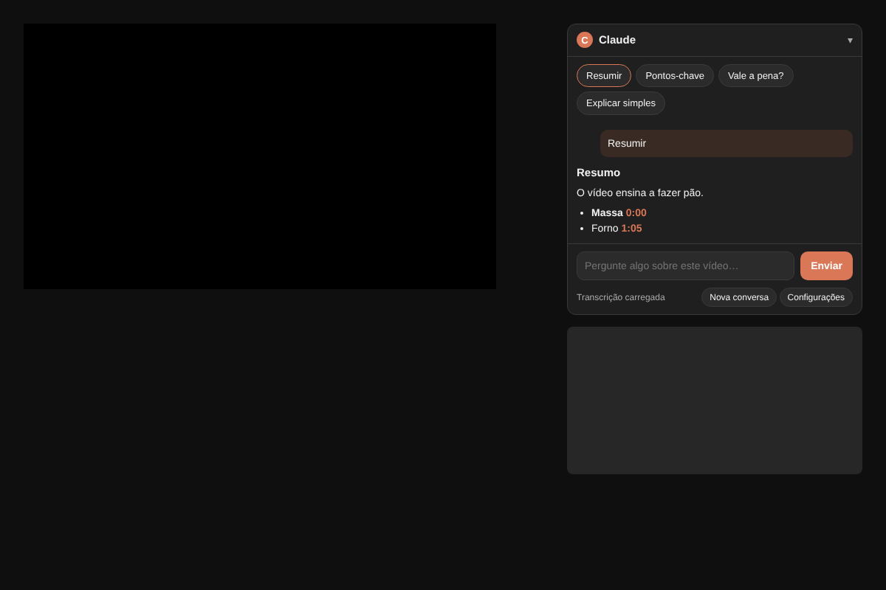

# Claude para YouTube

Extensão do Chrome que coloca o Claude ao lado de qualquer vídeo do YouTube.



## O que faz

- **Resumir**, **Pontos-chave**, **Vale a pena?** e **Explicar simples** com um clique
- Chat livre: pergunte qualquer coisa sobre o vídeo
- Lê a **transcrição** (legendas) do vídeo, então responde sobre o que é realmente falado
- Os tempos nas respostas (ex.: **1:05**) são clicáveis e pulam o vídeo até aquele ponto
- Acompanha o tema claro/escuro do YouTube e troca de conversa sozinho quando você muda de vídeo

## Como instalar

1. Baixe o arquivo `claude-youtube.zip` desta pasta e descompacte (ou use a pasta `extension/` direto).
2. No Chrome, abra `chrome://extensions`.
3. Ative o **Modo do desenvolvedor** (canto superior direito).
4. Clique em **Carregar sem compactação** e escolha a pasta `extension`.
5. A tela de configurações abre sozinha: cole sua chave da API do Claude
   (crie em https://platform.claude.com/settings/keys) e clique em **Salvar**.
6. Abra um vídeo no YouTube — o painel do Claude aparece em cima dos vídeos recomendados.

Funciona também no Edge, Brave e Opera (qualquer navegador baseado no Chromium).

## Bom saber

- O uso é cobrado na sua conta da API da Anthropic (não no plano do claude.ai).
  A transcrição fica em cache, então perguntas seguintes sobre o mesmo vídeo saem mais baratas.
- A chave fica salva só no seu navegador e vai apenas para `api.anthropic.com`.
- Vídeos sem legenda: o Claude usa só título e descrição e avisa isso.

## Para desenvolver

```bash
npm install
npm run build   # gera extension/background.js a partir de src/background.js
```

Arquivos:

| Arquivo | Papel |
|---|---|
| `src/background.js` | Fala com a API do Claude (SDK oficial) e transmite a resposta em tempo real |
| `extension/content.js` | Painel na página do vídeo, leitura da transcrição, chat |
| `extension/page-bridge.js` | Lê os dados do player do YouTube (título, legendas) |
| `extension/options.html` | Tela de configurações (chave, idioma, nível de capricho) |
